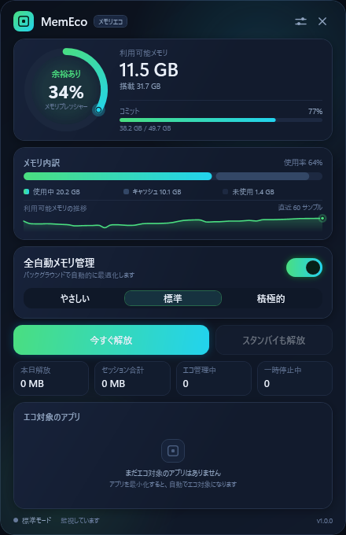
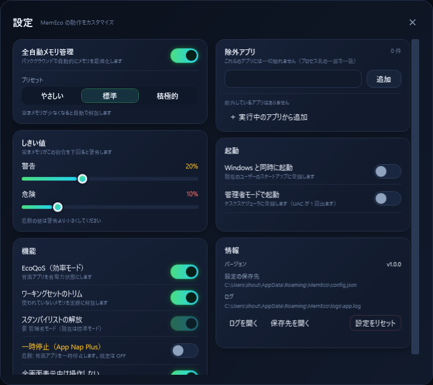

# MemEco

[](https://github.com/Madoa5561/MemEco/actions/workflows/build.yml)
[](https://github.com/Madoa5561/MemEco/releases/latest)
[](LICENSE)

> macOS の「メモリ管理」体験を Windows 11 に。
> 入れっぱなしで、勝手に、静かにメモリを整える常駐アプリ。

- 対象 OS: **Windows 11**（Build 22000 以降）
- ランタイム: **.NET 9**（WPF デスクトップ / framework-dependent）
- 外部 NuGet パッケージ: **なし**（SDK があればオフラインでビルド可能）
- ライセンス: **MIT**

MemEco は常駐してメモリの圧迫度を見張り、邪魔にならない範囲で
バックグラウンドアプリの消費電力を下げ、ワーキングセットを整理し、
必要ならスタンバイメモリを解放します。操作は最小限。既定のままでも動きます。

## ダウンロード（配布）

[GitHub Releases](https://github.com/Madoa5561/MemEco/releases/latest) から最新版を取得できます。

| ファイル | サイズ目安 | 必要なもの |
|---|---|---|
| `MemEco-1.0.0-win-x64.exe`（自己完結） | 約 66 MB | なし（.NET ランタイム不要） |
| `MemEco-1.0.0-win-x64-fd.exe`（framework-dependent） | 約 0.5 MB | .NET 9 デスクトップランタイム |

SHA-256 は Releases の `SHA256SUMS.txt` に添付しています。
どちらも単一 exe です。インストールせずに `MemEco.exe --show` で試せます。


## スクリーンショット





> 上記は `MemEco.exe --preview` で生成した実際の画面です。
> パネル 440x680 / 設定 720x640。

---

## 目次

1. [ダウンロード（配布）](#ダウンロード配布)
2. [できること / できないこと](#できること--できないこと)
3. [macOS との違い](#macos-との違い)
4. [動作環境](#動作環境)
5. [インストール](#インストール)
6. [使い方](#使い方)
7. [管理者モード](#管理者モード)
8. [仕組み](#仕組み)
9. [安全性](#安全性)
10. [制限事項](#制限事項)
11. [アンインストール](#アンインストール)
12. [ビルドと検証（開発者向け）](#ビルドと検証開発者向け)
13. [ファイル構成](#ファイル構成)
14. [ライセンス](#ライセンス)
15. [免責](#免責)

---

## できること / できないこと

### できること

- **メモリ圧迫度の可視化** — 空きメモリ・コミット・メモリ圧縮ストアから 0〜100% の
  「圧迫度」を計算し、トレイアイコンの色とパネルで表示します。
- **EcoQoS による省電力化** — 前面に無いアプリを Windows 11 の
  EcoQoS（`ProcessPowerThrottling`）+ 優先度 `BelowNormal` に切り替え、
  CPU を「省エネ寄り」に動かします。アプリは止まりません。
- **ワーキングセットのトリム** — 圧迫度が「注意」以上のとき、
  対象アプリのワーキングセット（物理メモリ上の作業領域）を解放します。
  解放した量は**実測**して表示します。
- **スタンバイリストの解放** — 管理者モードのときだけ、
  メモリのスタンバイリストを解放できます（`purge` 相当）。
- **App Nap Plus（一時停止 / 既定 OFF）** — 「積極的」プリセットで有効にすると、
  圧迫度が「危険」のときだけ、条件を満たす背面プロセスを一時停止します。
  停止したプロセスは必ず復帰します（最大時間・前面化・終了時に強制復帰）。
- **全自動** — 2 秒ごとに状態を判定し、しきい値を超えたときだけ動きます。
  既定は「標準」。ユーザー操作なしで動き続けます。
- **除外設定** — 触られたくないアプリを名前で除外できます。
- **CLI** — セルフテスト・プレビュー画像出力・単発のメモリ回収をコマンドから実行できます
  （[docs/USAGE.md](docs/USAGE.md)）。

### できないこと / やらないこと

- **macOS のメモリ圧縮を再実装することはしません。**
  Windows の Memory Compression は OS 標準機能です。MemEco はその使用量を
  **監視・表示するだけ**です。
- **物理メモリを増やすことはできません。** できるのは「不要な作業領域を手放させる」
  ところまでです。根本的な不足には PC の増設が必要です。
- **すべてのアプリを同じように扱うことはできません。**
  システム系・前面のアプリ・音声再生中・管理者権限で動くアプリ・
  除外設定したアプリには触れません（[安全性](#安全性)）。
- **スタンバイ解放は管理者モードのみ**です。標準ユーザーでもトリムは動きます。
- **Windows 10 以前は対象外**です（Windows 11 固有の API を使います）。

---

## macOS との違い

| macOS の機能 | MemEco（Windows 11） | 備考 |
|---|---|---|
| メモリプレッシャー表示 | `GlobalMemoryStatusEx` + `GetPerformanceInfo` + 圧縮ストア量から 0..1 スコア | 同等の考え方で独自算出 |
| App Nap（背面アプリの省電力化） | Windows 11 の **EcoQoS** + 優先度 `BelowNormal` | アプリは停止しません |
| メモリ圧縮 | Windows 標準の Memory Compression を**監視・表示のみ** | OS 機能を再実装しない |
| purge / メモリ解放 | ワーキングセットのトリム + スタンバイリスト解放（要管理者） | 解放量を実測 |
| スワップ監視 | ページファイル使用量・コミットチャージを監視 | — |
| 低メモリ時の自動退避 | 圧迫度「危険」時のみ背面プロセスを一時停止（**既定 OFF**） | 「積極的」プリセットで有効化 |

> macOS の App Nap はアプリのタイマーやネットワーク処理まで調整しますが、
> MemEco の EcoQoS は Windows が提供する範囲（CPU の省電力寄せ）に限定されます。
> 「macOS と完全に同じ」ではありません。

---

## 動作環境

| 項目 | 要件 |
|---|---|
| OS | Windows 11 Build 22000 以降（検証機: Build 26200） |
| ランタイム | .NET 9 **デスクトップランタイム**（WPF 用） |
| アーキテクチャ | x64 |
| 権限 | 標準ユーザーで動作（スタンバイ解放のみ管理者） |
| ネットワーク | 不要（外部パッケージ・外部通信なし） |

> 配布している exe は framework-dependent です。.NET 9 デスクトップランタイムが
> 入っていない環境では起動しません。`dotnet --list-runtimes` で
> `Microsoft.WindowsDesktop.App 9.x` を確認してください。

---

## インストール

### かんたんインストール（推奨）

リポジトリのルートで PowerShell を開き、次を実行します。

```powershell
powershell -ExecutionPolicy Bypass -File .\scripts\install.ps1
```

1. 必要に応じて **UAC の昇格確認**が出ます（ログオン時タスクの登録に必要）。
2. `%LOCALAPPDATA%\MemEco\app` にファイルをコピーします
   （`publish\` があれば優先、無ければ `bin\Release` を使用）。
3. ログオン時のタスク **MemEco** を登録します
   （`schtasks /SC ONLOGON /RL HIGHEST` = 管理者モードで自動起動）。
4. `HKCU\...\Run` の古い `MemEco` エントリを削除します（二重起動防止）。
5. スタートメニューにショートカットを作成します。

オプション:

| オプション | 動作 |
|---|---|
| `-InstallDir <path>` | インストール先を変更（既定 `%LOCALAPPDATA%\MemEco\app`） |
| `-NoElevate` | UAC 昇格を行わない（タスク登録はスキップ） |
| `-NoShortcut` | スタートメニューのショートカットを作らない |
| `-Uninstall` | アンインストール |
| `-Purge` | `-Uninstall` 時に設定・ログも削除 |

### インストールせずに使う

ビルド済み exe を直接起動しても動きます。

```powershell
.\src\MemEco.App\bin\Release\net9.0-windows\MemEco.exe --show
```

この場合、自動起動は登録されません。必要な場合は設定画面の
「Windows と同時に起動」またはタスクスケジューラを使ってください。

### アンインストール

```powershell
powershell -ExecutionPolicy Bypass -File .\scripts\uninstall.ps1
```

設定とログ（`%APPDATA%\MemEco`）も消す場合:

```powershell
powershell -ExecutionPolicy Bypass -File .\scripts\uninstall.ps1 -Purge
```

---

## 使い方

詳細な 1 ページ版は [docs/USAGE.md](docs/USAGE.md) を参照してください。

### 起動と常駐

- インストール後は Windows へのログオン時に自動で起動します（トレイのみ）。
- 初回起動時だけパネルが表示されます。2 回目以降はトレイに常駐します。
- **二重起動はしません。** 2 個目を起動すると、既存の MemEco にパネル表示を
  通知してすぐ終了します。
- 終了はトレイメニューから明示的に行います。× ボタンは「トレイに格納」です。

### トレイメニュー

| 操作 | 動作 |
|---|---|
| トレイアイコンを左クリック | パネルの表示 / 非表示 |
| 右クリック → パネルを開く | パネルを表示 |
| 右クリック → 今すぐ解放 | 単発のメモリ回収を実行 |
| 右クリック → 設定 | 設定画面を開く |
| 右クリック → 終了 | 常駐を終了（一時停止中のプロセスは復帰） |

トレイアイコンの色は圧迫度を表します（緑 = 余裕 / 琥珀 = 注意 / 赤 = 危険）。

### パネル

- **メモリプレッシャーリング** — 圧迫度を円弧と「余裕あり / 注意 / 危険」で表示。
- **メモリ内訳バー** — 使用中 / キャッシュ（スタンバイ）/ 空きと、コミット量。
- **空きメモリのスパークライン** — 直近の推移。
- **全自動メモリ管理 ON/OFF** — これをオフにすると自動処理を止めます
  （表示・記録は継続）。
- **プリセット** — やさしい / 標準 / 積極的。
- **今すぐ解放** — その場でワーキングセットを整理します。
- **スタンバイも解放** — 管理者モードのときだけ押せます。
- **実績** — 本日解放 / セッション合計 / エコ管理中 / 一時停止中。
- **エコ管理中のアプリ一覧** — どのアプリをどれだけ整理したか。

### 設定画面

- 自動管理の ON/OFF、プリセット、しきい値スライダー
- 機能スイッチ（EcoQoS / トリム / スタンバイ解放 / 一時停止）
- 除外アプリの追加・削除（実行中プロセスから選ぶこともできます）
- 起動設定（Windows と同時に起動 / 管理者モードで起動）
- 情報（バージョン、設定保存先、ログを開く、設定リセット）

設定は `%APPDATA%\MemEco\config.json` に保存され、次回起動時に復元されます。
ファイルが壊れている場合は既定値で起動します。

### プリセットの違い

| プリセット | 動き出すタイミング | 一時停止 | 対象の最小メモリ |
|---|---|---|---|
| やさしい | 空きが 15% 未満 / 危険 8% 未満 | 使わない | 150 MB |
| 標準（既定） | 空きが 20% 未満 / 危険 10% 未満 | 使わない | 100 MB |
| 積極的 | 空きが 25% 未満 / 危険 15% 未満 | 使う（10 分アイドル） | 64 MB |

---

## 管理者モード

### 管理者モードでできること

- **スタンバイリストの解放**（`NtSetSystemInformation` / MemoryPurgeStandbyList）。
  標準ユーザーでは OS がこの操作を拒否します。
- 管理者権限で動いているアプリに対する操作の成功率が上がります
  （権限のないプロセスは静かにスキップされます）。

### 管理者モードの設定方法

1. `scripts\install.ps1` を実行すると、ログオン時タスクが
   **管理者モード（`/RL HIGHEST`）** で登録されます。
2. 設定画面の「管理者モードで起動」からも登録できます（UAC が 1 回出ます）。
3. 手動で登録する場合:

```powershell
schtasks /Create /TN "MemEco" /TR "\"%LOCALAPPDATA%\MemEco\app\MemEco.exe\" --autostart" /SC ONLOGON /RL HIGHEST /F
```

管理者モードでない場合、パネルのフッターに「標準モード」と表示され、
スタンバイ解放のボタンは無効になります。**トリムや EcoQoS は標準ユーザーでも動きます。**

### 管理者モードの注意

- タスクは「ログオン時」に起動します。ログオン後に登録した場合は、
  次回ログオンから有効です（今すぐ使うには一度手動で起動してください）。
- 不要になったらアンインストーラまたは `schtasks /Delete /TN "MemEco" /F` で削除します。

---

## 仕組み

MemEco は 2 秒ごとにメモリとプロセスを観測し、しきい値を超えたときだけ動きます。
観測と判断は UI から独立したエンジン（MemEco.Core）が行い、UI は結果を描画するだけです。

### メモリプレッシャーの算出

```
availRatio  = 空き物理メモリ / 搭載物理メモリ
commitRatio = コミット / コミット上限
availScore  = clamp01((0.28 - availRatio) / 0.22)
commitScore = clamp01((commitRatio - 0.70) / 0.25)
compScore   = clamp01((圧縮ストア量 / 搭載物理メモリ - 0.10) / 0.20)
score       = clamp01(max(availScore, commitScore) + 0.35 * compScore)

余裕あり: score < 0.45
注意    : 0.45 <= score < 0.75
危険    : score >= 0.75
```

### エコ（EcoQoS）

- 前面に無く、可視ウィンドウが無く、CPU 使用が 1.5% 未満で、
  `EcoIdleMinutes` 以上アイドルのアプリを対象にします。
- `SetProcessInformation(ProcessPowerThrottling)` で EcoQoS を有効化し、
  優先度を `BelowNormal` にします。**プロセスは停止しません。**
- 前面化・可視化・音声再生・設定オフ・保護対象化のいずれかで解除し、
  元の優先度に戻します。

### ワーキングセットのトリム

- 圧迫度が「注意」以上のときだけ、対象プロセスのワーキングセットを解放します。
- `EmptyWorkingSet` を使い、**解放前後のワーキングセットを実測**して統計に加算します。
  見かけの数字は作りません。
- 同じプロセスは 60 秒に 1 回までです。

### スタンバイリストの解放

- 管理者モードかつ「警告」以上、クールダウン経過時のみ実行します。
- 失敗しても例外は投げず、ログに残して継続します。

### App Nap Plus（一時停止 / 既定 OFF）

- 圧迫度が「危険」かつ `SuspendIdleMinutes` 以上アイドルの背面プロセスだけを
  `NtSuspendProcess` で一時停止します。
- **子プロセスを持つプロセスは対象外**です。
- `MaxSuspendMinutes` を超えると強制復帰します。
- 前面化・可視化・設定オフ・アプリ終了時にも必ず復帰します。
- 危険な操作のため既定は OFF、プリセット「積極的」でのみ有効になります。

---

## 安全性

MemEco は「メモリを空けること」より「**壊さないこと**」を優先します。

### 触らないプロセス

- システム / OS の重要プロセス
- 前面のアプリ、可視ウィンドウを持つアプリ
- 音声を再生中のアプリ
- 管理者権限で動いているアプリ（昇格済み）
- 自分自身とその親プロセス
- 起動から 60 秒未満のプロセス
- 設定で除外したアプリ
- 一時停止の対象外: 子プロセスを持つプロセス

### 必ず復帰します

- 一時停止したプロセスは、前面化・可視化・設定オフ・最大時間経過・
  MemEco の終了時に必ず復帰します。
- 復帰処理は例外が起きても試行し、失敗はログに残します。

### 全画面時は止まります

- 全画面のゲーム・プレゼン中（`SHQueryUserNotificationState`）は
  新しい操作を行いません。

### 数字は実測値だけ

- 解放量は `EmptyWorkingSet` の前後のワーキングセット差から算出します。
- 「空けたつもり」の値は表示しません。

### 権限がないときは静かにスキップ

- 操作権限のないプロセスには何もせず、ログに残して次へ進みます。
- エンジンのループは例外で止まりません。

---

## 制限事項

- **メモリ圧縮は OS 標準機能**です。MemEco は圧縮そのものを制御しません。
- **スタンバイ解放は管理者モードのみ**です。
- **一時停止（App Nap Plus）は既定 OFF**です。有効化は自己責任で。
- ワーキングセットを解放しても、アプリが再度メモリを触れば元に戻ります。
  「劇的に空きが増え続ける」ものではありません。
- 管理者権限で動くアプリの内部状態までは関与できません。
- Windows 10 以前、ARM64、Server 系は対象外です。
- 計測値はハードウェア・実行中のアプリ・Windows の状態で変動します。

---

## 実測値（受け入れ検証）

**検証日**: 2026-10-28 02:42 / Windows 11 Build 26200 / 28 論理 CPU / 標準ユーザー（非管理者） /
所要 94.6 秒 / **PASS 17・FAIL 0・SKIP 0**

| 項目 | 結果 | 実測 |
|---|---|---|
| ビルド | PASS | `dotnet build .\MemEco.sln -c Release` 0 エラー（exe 0.21 MB） |
| publish（単一 exe） | PASS | `publish\MemEco.exe` 0.49 MB（framework-dependent / オフライン可） |
| `--selftest` | PASS | 合計 31.68 GB / 空き 12.41 GB (39.2%) / コミット 38.16 GB・上限 49.68 GB (76.8%) / キャッシュ 10.50 GB / 圧縮 4.97 GB / プレッシャー 37% (Normal) / プロセス走査 402 件・47 ms / exit 0 |
| `--preview` | PASS | 440x680 / 102,488 bytes（約 100 KB）/ 標準偏差 37.11（白紙でない）/ exit 0 |
| 常駐アイドル CPU（5 秒平均） | PASS | **0.07%（28 論理 CPU 平均）** / 1 コア換算 1.88% |
| 常駐ワーキングセット | PASS | **78.1 MB**（設計目標 80 MB / 判定上限 120 MB） |
| トリム実測（300 MB ホッグ） | PASS | ホッグ WS **418.1 MB → 0 MB（417.4 MB 削減）**。`--reclaim` は 15 アプリから計 **1,969.2 MB** 解放（success=true / standbyPurged=false = 非管理者のため正常） |
| 設定ファイル | PASS | `%APPDATA%\MemEco\config.json` 597 bytes / JSON 妥当 |

補足:

- **CPU の表記**: タスク マネージャー相当（全論理 CPU 平均）で **0.07%**、1 コア換算で **1.88%** です。
  設計目標は「全コア平均で 1% 未満」。
- 解放量は環境や直前に何をしていたかで変動します（ホッグ 417 MB + 他アプリのワーキングセット）。
- 検証は `--autostart` / `--selftest` / `--preview` / `--reclaim` のみを使用します
  （レジストリ・タスク・スタートメニューは変更しません）。

再現方法:

```powershell
powershell -ExecutionPolicy Bypass -File .\tools\verify.ps1
```

---

## トラブルシューティング

| 症状 | 確認すること |
|---|---|
| 起動しない | `.NET 9 デスクトップランタイム` が入っているか（`dotnet --list-runtimes`） |
| 二重に起動したように見える | 仕様です。2 個目は既存に通知して終了します |
| スタンバイ解放が押せない | 管理者モードで起動しているか（フッターの表示を確認） |
| 自動起動しない | `schtasks /Query /TN "MemEco"` でタスクの有無、`%APPDATA%\MemEco\logs\app.log` を確認 |
| 設定を初期化したい | 設定画面の「リセット」または `%APPDATA%\MemEco\config.json` を削除 |
| ログを見たい | `%APPDATA%\MemEco\logs\app.log`（1 MB でローテーション） |

ログと設定の場所:

```
%APPDATA%\MemEco\config.json
%APPDATA%\MemEco\logs\app.log
```

---

## ビルドと検証（開発者向け）

### 必要なもの

- .NET 9 SDK
  - 本リポジトリの検証環境では `%LOCALAPPDATA%\Microsoft\dotnet\dotnet.exe`（9.0.320）を使用
- Windows 11
- 外部 NuGet パッケージは不要

### ビルド

```powershell
powershell -ExecutionPolicy Bypass -File .\scripts\build.ps1
```

- `dotnet build .\MemEco.sln -c Release` を実行します。
- 続けて framework-dependent の単一 exe を `publish\` に生成します
  （ランタイムパック取得に失敗した場合は警告して通常ビルドにフォールバック）。
- オフライン環境では `-SkipPublish` を付けてください。

出力:

```
src\MemEco.App\bin\Release\net9.0-windows\MemEco.exe
publish\MemEco.exe        （publish 成功時）
```

### 受け入れ検証

```powershell
powershell -ExecutionPolicy Bypass -File .\tools\verify.ps1
```

ビルド → `--selftest` → `--preview`（440x680 PNG の検証）→ 常駐 12 秒の
CPU / ワーキングセット計測 → 300 MB のメモリホッグを `--reclaim` で実際に
減らせるかの実測 → 設定ファイル生成、を自動で確認し、PASS/FAIL と終了コードを返します。
CPU はタスク マネージャー相当（全論理 CPU 平均）で判定し、1 コア換算値も表示します。
トリム実測では、安全性ポリシー（`\System32\` 保護・起動 60 秒未満保護）を避けるため、
ホッグを一時フォルダの `MemEcoHog.exe` として起動し 62 秒待ってから `--reclaim` します。
検証で起動したプロセスはすべて停止し、一時ファイルも削除します
（レジストリ・タスクは変更しません）。

ビルドをスキップする場合:

```powershell
.\tools\verify.ps1 -SkipBuild
```

### 単体で動かす

```powershell
$exe = ".\src\MemEco.App\bin\Release\net9.0-windows\MemEco.exe"
& $exe --selftest .\selftest.txt
& $exe --preview  .\preview.png
& $exe --show
```

### アンインストール（開発時）

```powershell
.\scripts\uninstall.ps1 -Purge
```

---

## ファイル構成

```
MemEco.sln
src/
  MemEco.App/     WPF 常駐 UI（トレイ・パネル・設定・CLI）
  MemEco.Core/    監視・判断・操作（UI 非依存）
scripts/
  build.ps1       Release ビルド + publish
  install.ps1     インストール / アンインストール
  uninstall.ps1   アンインストーラ
tools/
  verify.ps1      受け入れ自動検証
  make_icon.py    アイコン生成
docs/
  DESIGN.md       設計書
  USAGE.md        クイックリファレンス
  preview*.png    スクリーンショット
assets/
  icon.ico        アプリアイコン
.github/
  workflows/build.yml  CI（ビルド + selftest + 単一 exe 生成）
LICENSE
```

---

## ライセンス

MIT License

```
Copyright (c) 2026 Madoa5561

Permission is hereby granted, free of charge, to any person obtaining a copy
of this software and associated documentation files (the "Software"), to deal
in the Software without restriction, including without limitation the rights
to use, copy, modify, merge, publish, distribute, sublicense, and/or sell
copies of the Software, and to permit persons to whom the Software is
furnished to do so, subject to the following conditions:

The above copyright notice and this permission notice shall be included in all
copies or substantial portions of the Software.

THE SOFTWARE IS PROVIDED "AS IS", WITHOUT WARRANTY OF ANY KIND, EXPRESS OR
IMPLIED, INCLUDING BUT NOT LIMITED TO THE WARRANTIES OF MERCHANTABILITY,
FITNESS FOR A PARTICULAR PURPOSE AND NONINFRINGEMENT. IN NO EVENT SHALL THE
AUTHORS OR COPYRIGHT HOLDERS BE LIABLE FOR ANY CLAIM, DAMAGES OR OTHER
LIABILITY, WHETHER IN AN ACTION OF CONTRACT, TORT OR OTHERWISE, ARISING FROM,
OUT OF OR IN CONNECTION WITH THE SOFTWARE OR THE USE OR OTHER DEALINGS IN THE
SOFTWARE.
```

---

## 免責

- 本ソフトウェアは無保証です。使用により生じたいかなる損害についても、
  作者は責任を負いません。
- メモリ操作はプロセスの状態に影響します。重要な作業中は
  全自動をオフにするか、MemEco を終了してください。
- 一時停止機能（App Nap Plus）は既定で無効です。有効化する場合は
  自己責任でお願いします。
- Windows のバージョン・更新プログラム・実行中のアプリによって挙動が変わります。
